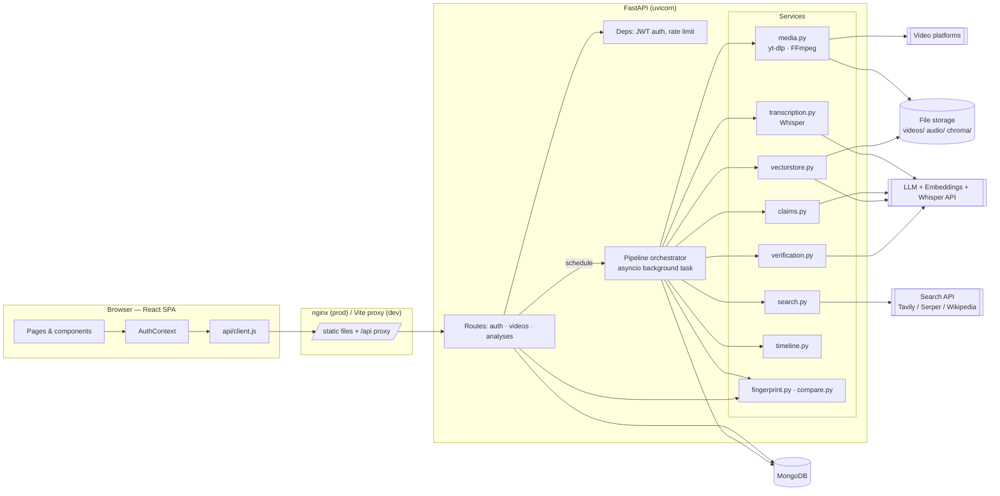
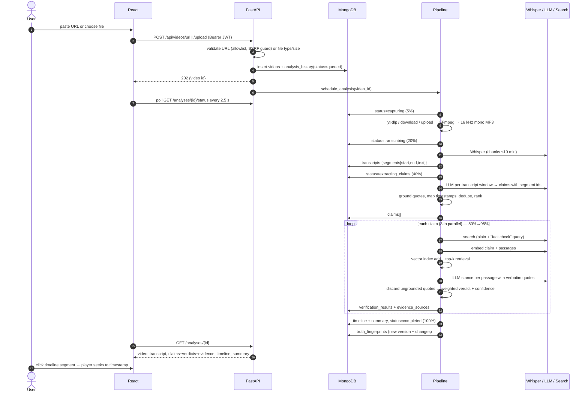
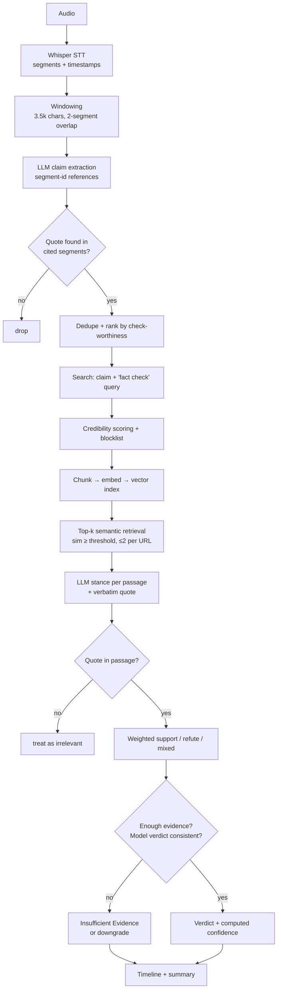
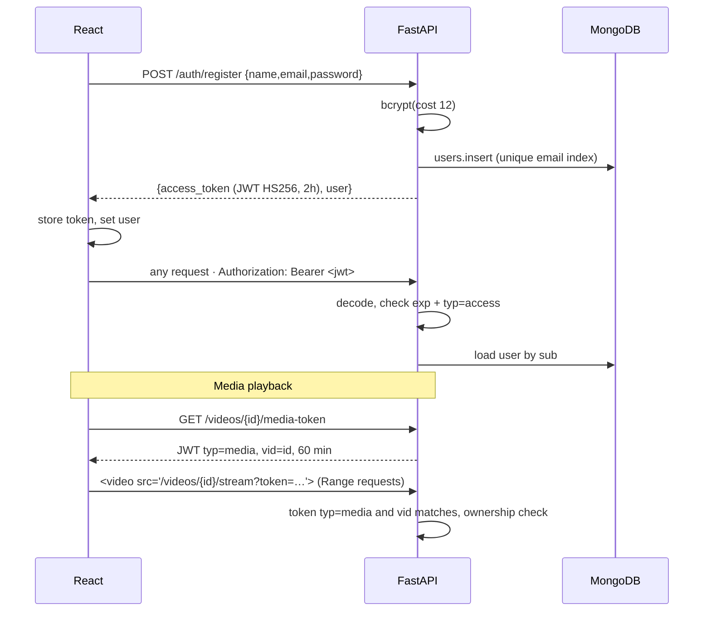

# System Architecture

## 1. System architecture

## 2. Data flow (one analysis)

## 3. Frontend architecture
- **Routing** (`App.jsx`): public `/`, `/login`, `/register`; protected `/dashboard`, `/analysis/:videoId`, `/history` wrapped in `ProtectedRoute` + `AppLayout` (sidebar on desktop, drawer on mobile).
- **State**: `AuthContext` holds the user and token (stored in `localStorage`, read via `tokenStore`). Page-level state otherwise; no global store needed.
- **Data access**: `api/client.js` adds the bearer token, normalises errors into `ApiError(message, status, code)`, signs out on 401. `uploadWithProgress` uses XHR for upload progress.
- **Live progress**: `useAnalysis` polls `/status` (cheap) and only refetches the full result when progress changes, so claims appear as they're verified. Stops when completed or failed. A retry restarts it.
- **Analysis view**: `VideoPlayer` exposes `seekTo()` through a ref and works for streamed files (`<video>` + media token), YouTube/Vimeo embeds (postMessage), or a link-out fallback. `TruthTimeline`, `TranscriptViewer` and `ClaimCard` all call the same `seek` + `selectClaim` callbacks, so the views stay in sync.
- **Design system**: Tailwind theme with `navy` scale, off-white `paper` background, `card` component class, verdict colours shared through `utils/format.js`. Framer Motion for tab, list and timeline transitions (respects `prefers-reduced-motion`). Recharts for the dashboard donut and summary bars.

## 4. Backend architecture
Layered so each part is testable on its own:

| Layer | Responsibility |
|---|---|
| `api/routes` | HTTP only: parse input, check ownership, call services, serialise |
| `api/deps` | authentication, rate limiting |
| `services` | all domain logic; raise `AppError` subclasses, never `HTTPException` |
| `db/mongo` | connection, collection names, indexes |
| `core` | config, security, errors, logging |

- **Error handling**: every `AppError` becomes `{"error": {"code", "message", "details"}}` with the right status; validation errors use the same shape; unexpected errors are logged with a stack trace and return a generic 500.
- **Background work**: `pipeline.schedule_analysis` starts an asyncio task; blocking work (FFmpeg, yt-dlp, local Whisper) runs in `asyncio.to_thread`. Progress is written to `analysis_history`, so any API instance can serve status. Analyses interrupted by a restart are marked failed on startup and can be retried. For scale, move `run_analysis(video_id)` into a queue worker (Arq/Celery). Its interface already takes only an id.
- **Logging**: request id, method, path, status and latency per request. JSON logs in production.

## 5. AI processing pipeline
See [AI_PIPELINE.md](AI_PIPELINE.md) for each stage in detail.

## 6. Authentication architecture

- Passwords: bcrypt, never returned. Login is rate-limited per IP+email.
- Access tokens are stateless JWTs with a `typ` claim, so a media token can't be used as an access token or the other way round.
- Every query filters by `user_id`, so users can only see their own analyses (covered by a test).
- Production hardening options are in [DEPLOYMENT.md](DEPLOYMENT.md#security).

## 7. How components communicate
| From → To | Channel | Format |
|---|---|---|
| Browser → API | HTTPS REST via nginx `/api` | JSON; multipart for uploads; Range for media |
| API → Pipeline | in-process asyncio task | `video_id` |
| Pipeline → MongoDB | Motor (async) | documents per collection |
| Pipeline → OpenAI-compatible API | HTTPS (official SDK) | chat JSON mode, embeddings, audio transcription |
| Pipeline → Search API | HTTPS (httpx) | JSON results |
| Pipeline → platforms | yt-dlp | audio-only stream |
| Pipeline → FFmpeg | subprocess | files on disk |
| Frontend ↔ progress | polling `/status` | small JSON |
