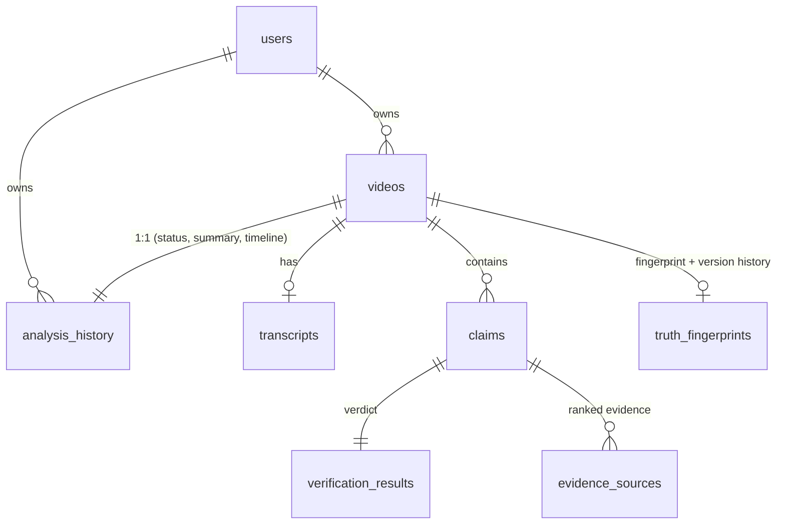

# Database Design (MongoDB)

All `_id`s are UUID4 hex strings (`app.db.mongo.new_id`), which keeps JSON simple and makes ids safe to put in URLs. Timestamps are timezone-aware UTC.

## Relationships

`video_id` is copied onto transcripts, claims, results and evidence. A whole analysis then loads with one indexed query per collection, with no joins, and deletes the same way.

## Collections

### users
| Field | Type | Notes |
|---|---|---|
| `_id` | str | |
| `name` | str | ≤ 80 chars |
| `email` | str | lower-cased, **unique index** |
| `password_hash` | str | bcrypt |
| `created_at` | datetime | |

### videos
| Field | Type | Notes |
|---|---|---|
| `_id` | str | also the analysis id used in URLs |
| `user_id` | str → users | |
| `title` | str | user title, or the platform title once captured |
| `title_is_default` | bool | replace with platform title if true |
| `source_type` | `platform` \| `direct` \| `upload` | |
| `source_url` | str? | original link |
| `platform` | str? | `youtube`, `vimeo`, `x`, … |
| `embed_url` | str? | privacy-enhanced embed |
| `file_path` | str? | stored file for uploads / direct links |
| `playable` | bool | backend can stream it |
| `duration` | float? | seconds |
| `meta` | object? | uploader, upload date, thumbnail (platform videos) |
| `original_filename`, `size_bytes` | | uploads only |
| `created_at` | datetime | |
Index: `(user_id, created_at desc)`

### analysis_history
| Field | Type | Notes |
|---|---|---|
| `_id` | str | |
| `video_id` | str → videos | **unique** |
| `user_id` | str → users | |
| `status` | `queued` \| `capturing` \| `transcribing` \| `extracting_claims` \| `verifying` \| `completed` \| `failed` | |
| `stage_label` | str | human-readable stage |
| `progress` | int 0–100 | |
| `error` | str? | user-facing failure reason |
| `timeline` | array | `[{claim_id, start, end, verdict, color, label, text}]` |
| `summary` | object? | `{total_claims, counts{verified,false,misleading,unverified}, truth_score, overall_rating, overall_explanation}` |
| `created_at`, `updated_at`, `started_at`, `completed_at` | datetime | |
Index: `(user_id, created_at desc)`

### transcripts
| Field | Type | Notes |
|---|---|---|
| `_id` | str | |
| `video_id` | str | **unique** |
| `language` | str? | detected by Whisper |
| `full_text` | str | |
| `segments` | array | `[{id:int, start:float, end:float, text:str}]` |
| `created_at` | datetime | |

### claims
| Field | Type | Notes |
|---|---|---|
| `_id` | str | |
| `video_id` | str | |
| `text` | str | self-contained, rewritten claim |
| `original_quote` | str | verbatim words from the transcript |
| `start`, `end` | float | seconds, taken from the cited segments |
| `segment_ids` | int[] | transcript segments it came from |
| `claim_type` | enum | statistical, historical, scientific, health, political, economic, quote, other |
| `checkworthiness` | float 0–1 | used for ranking |
| `embedding` | float[] | claim embedding, kept for cross-video matching (excluded from API responses) |
| `created_at` | datetime | |
Index: `(video_id, start)`

### verification_results
| Field | Type | Notes |
|---|---|---|
| `_id` | str | |
| `claim_id` | str → claims | **unique** |
| `video_id` | str | indexed |
| `verdict` | `verified` \| `false` \| `misleading` \| `unverified` | |
| `label`, `color` | str | display values |
| `confidence` | float? | evidence-based; null when insufficient |
| `explanation` | str | cites `[E#]` = evidence rank |
| `confidence_breakdown` | object | support/refute/mixed weights, source counts, strength, agreement, diversity, model suggestion |
| `adjusted` | bool | evidence checks overrode the model's verdict |
| `model` | str | LLM used |
| `created_at` | datetime | |

### evidence_sources
| Field | Type | Notes |
|---|---|---|
| `_id` | str | |
| `claim_id`, `video_id` | str | |
| `rank` | int | matches `[E#]` in the explanation |
| `title`, `url`, `source_name` | str | |
| `snippet` | str | retrieved passage (≤ 600 chars) |
| `stance` | `supports` \| `refutes` \| `mixed` \| `irrelevant` | |
| `quote` | str? | verbatim sentence, checked against the passage |
| `relevance` | float | cosine similarity to the claim |
| `credibility` | float | source tier weight |
| `published` | str? | |
| `retrieved_at` | datetime | |
Index: `(claim_id, rank)`

### truth_fingerprints
| Field | Type | Notes |
|---|---|---|
| `_id` | str | |
| `video_id` | str → videos | **unique** |
| `user_id` | str → users | |
| `fingerprint_id` | str | `LTS-XXXX-XXXX-XXXX`, **unique** |
| `current` | object | latest fingerprint: `content_hash`, `video`, `total_claims`, `counts`, `truth_score`, `overall_rating`, `evidence_quality{score,grade,label,coverage,avg_credibility,source_diversity,avg_confidence,grounded_sources,distinct_domains,fact_checker_sources}`, `timestamps[]`, `claims[{claim_id,key,text,start,end,verdict,confidence,sources[{url,domain,stance,credibility}]}]` |
| `versions` | array | `[{version, content_hash, verified_at, model, total_claims, counts, truth_score, evidence_quality, evidence_grade, changes{verdict_changes, added_claims, removed_claims, unchanged}}]`, last 50 |
| `created_at`, `updated_at` | datetime | |
Indexes: `video_id` unique, `fingerprint_id` unique, `(user_id, updated_at desc)`

### Additional collections
| Collection | Purpose | Key fields · indexes |
|---|---|---|
| `deepfake_analysis` | media authenticity job + result | `video_id` (unique), `status`, `result{outcome, indicators, checks, limitations}` |
| `reports` | generated PDFs | `user_id`+`created_at`, `video_id`, `file_path`, `fingerprint_id`, `version` |
| `translations` | translation cache | `_id` = sha256(lang + text), `lang`, `text` |
| `search_cache` | evidence search cache | `_id` = sha256(provider + query), TTL on `created_at` (`SEARCH_CACHE_HOURS`) |

New fields: `claims.code`, `claims.text_en`, `claims.language`, `claims.context_analysis`, `claims.embedding` · `evidence_sources.trust_score`, `evidence_sources.trust` · `analysis_history.context_summary`, `metrics`, `last_checked_at`, `is_sample` · `users.preferred_language`.

### Brief collection names → this schema
`Users` → `users` · `Videos` → `videos` · **`AnalysisJobs` → `analysis_history`** (status, progress, stage, error, metrics: one job per video, re-runs tracked via fingerprint versions) · `Transcripts` → `transcripts` · `Claims` → `claims` · `VerificationResults` → `verification_results` · `EvidenceSources` → `evidence_sources` · `TruthFingerprints` → `truth_fingerprints` · `DeepfakeAnalysis` → `deepfake_analysis` · `Reports` → `reports`.

IDs are UUID strings rather than ObjectIds, so they serialise cleanly to JSON and are safe in URLs. Relationships are enforced in code and every query is filtered by `user_id`. Validation happens in Pydantic at the API boundary.

### Retention
`RETENTION_DAYS` (default off) deletes stored video files and PDF reports older than N days. Analysis results and fingerprints are kept, and the video simply stops being playable. Deleting an analysis removes every related document and file immediately.

## Lifecycle
- **Create**: `POST /videos/*` inserts `videos` + `analysis_history(queued)`.
- **Run**: the pipeline fills `transcripts → claims → verification_results + evidence_sources`, then writes `timeline` and `summary` onto `analysis_history`.
- **Fingerprint**: recorded when the analysis completes; each completion appends a version.
- **Retry**: deletes the four result collections for the video and re-queues it. The fingerprint and its history are kept.
- **Delete**: removes all docs for the video (including its fingerprint) and the stored file.
